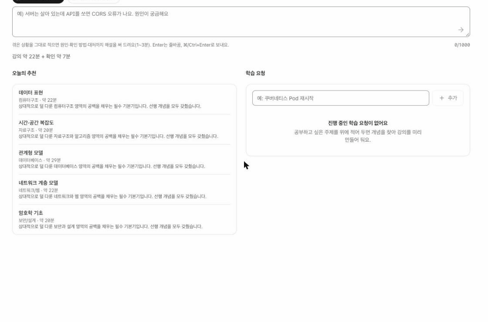
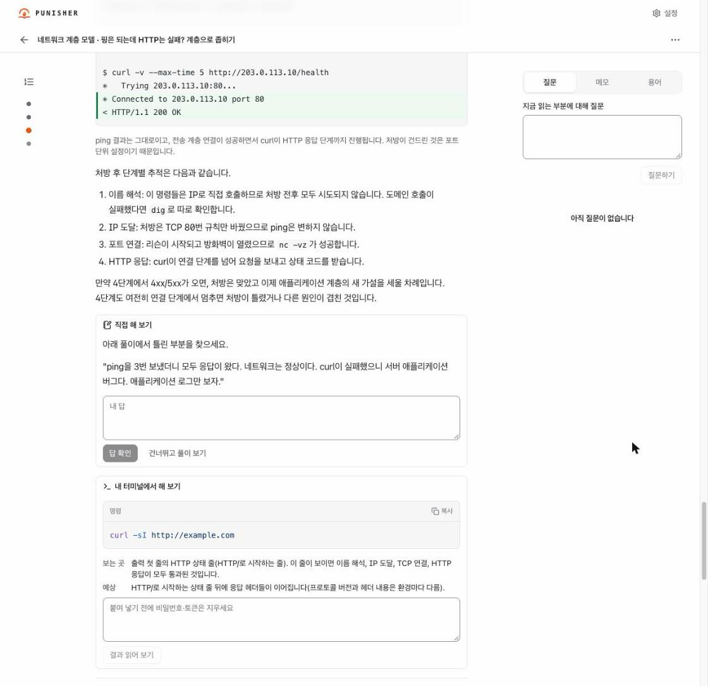
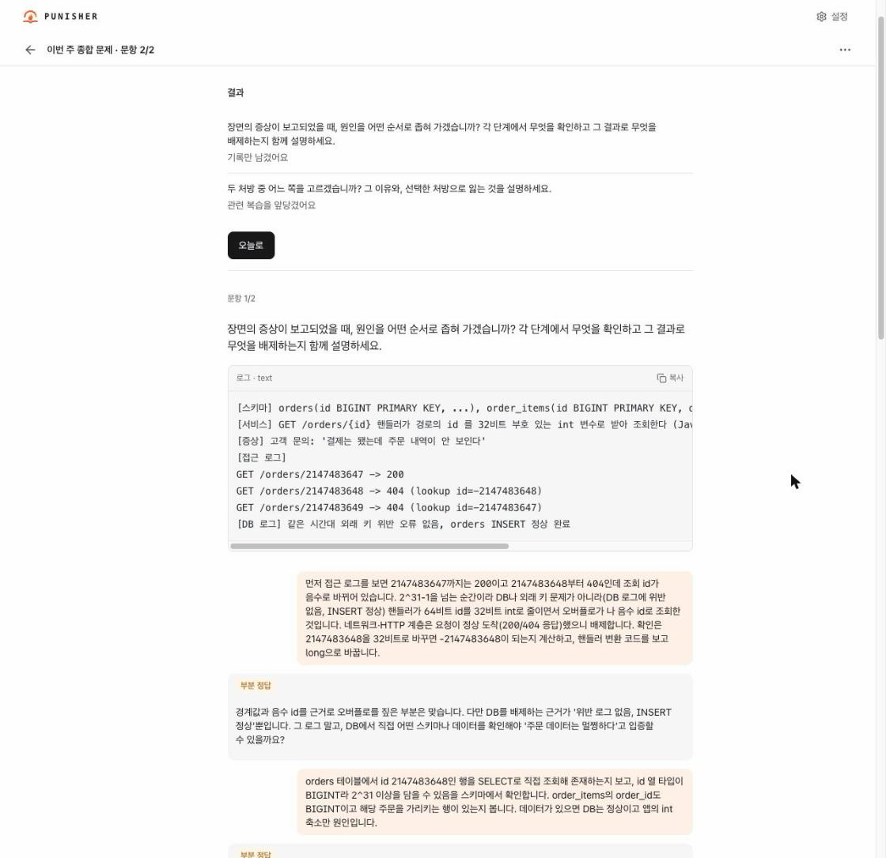
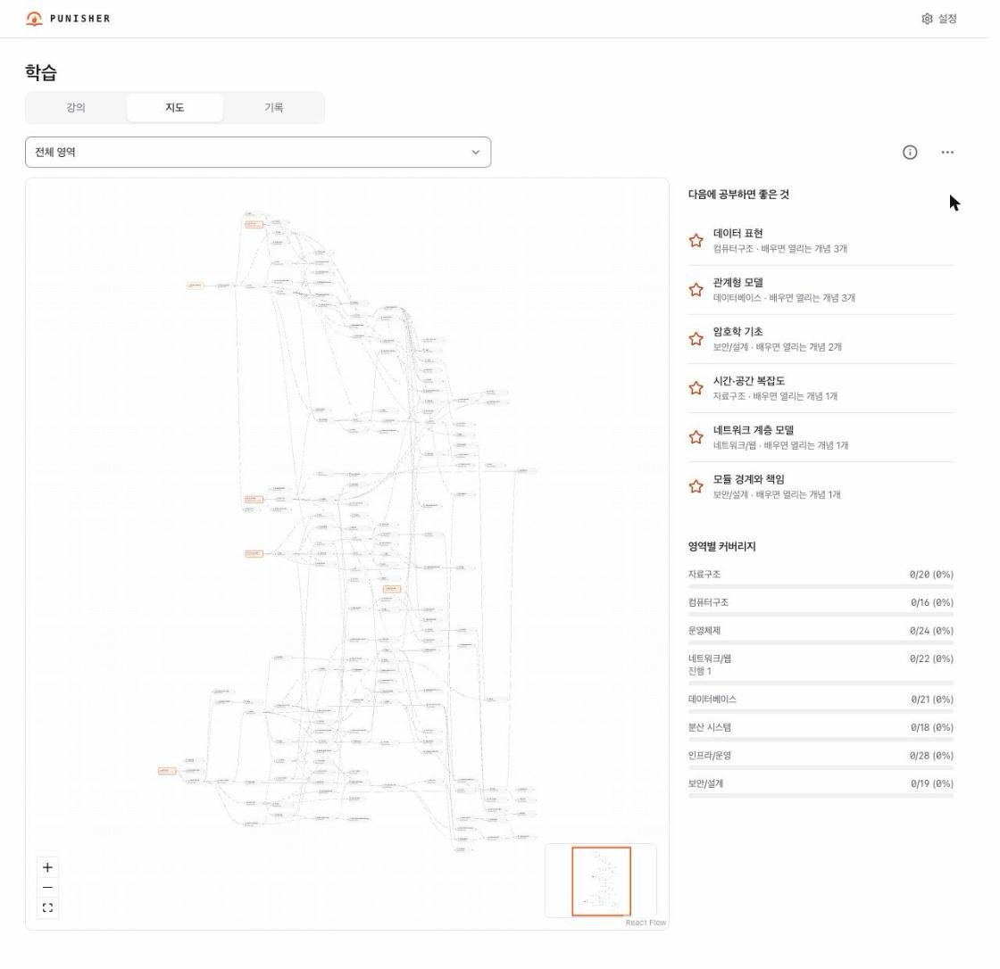

<p align="center">
  
</p>

<p align="center">
  <strong>Thirty minutes of CS fundamentals a day, written for you by Claude Code.</strong><br/>
  Runs on your own computer (macOS or Linux), and generates lectures with your own Claude Code login.
</p>

<p align="center">
  <a href="LICENSE"></a>
  
  
  <a href="https://github.com/forgen-team/punisher/actions/workflows/ci.yml"></a>
  <a href="https://github.com/forgen-team/forgen"></a>
</p>

<p align="center">
  English &middot; <a href="README.ko.md">한국어</a>
</p>

---

> **Lectures are written by AI and can be wrong.** Every lecture passes a factual review before it is published, but check the sources and the review badge, and treat numbers and version-specific details with care.

<p align="center">
  
  
  
  
</p>

## What it is

Punisher is a personal learning app for computer-science fundamentals. The UI is in Korean.

- **Today's lecture.** It recommends the next concept to study and writes a ~30-minute lecture on it, streamed live as Claude writes.
- **Read actively.** Tap a term for a short gloss, select a passage for "explain this part", ask questions, take notes. "Go deeper" lectures stay linked under the lecture you came from.
- **Practice while reading.** "직접 해 보기" exercises ask for your answer before showing the solution, with a one-line tutor comment. Some lectures add a lab: one read-only command to run in your own terminal (`lsof`, `dig`, `curl -I` …); paste the output and the tutor reads it with you.
- **Check and review.** After a lecture, answer a few short questions; a tutor narrows the question instead of giving the answer. Say how sure you are before answering — a confident wrong answer is called out as a misconception. Each learning objective builds a mastery level, and spaced reviews (1, 7, 30 days by default, adjusted per objective) bring it back.
- **Weekly synthesis.** Once you have checked a few concepts, a weekly problem mixes 3–4 of them in one realistic scene.
- **Lectures that improve.** Where you got stuck (missed exercises, labs, questions) shows up as "고칠 곳", and remaking the lecture uses it.
- **Reviewed lectures.** Every lecture passes a factual review before it is published; generation shows only the writing → review → fix stages.
- **Knowledge map.** 168 concepts across 8 areas (data structures, computer architecture, OS, network/web, databases, distributed systems, infra/ops, security/design) with your progress and goals.
- **Study requests.** Write down a topic; Punisher finds the concept and prepares its lecture in advance.
- **Your prompts.** Every instruction block (outline → lecture → review → gloss → Q&A → explain) can be viewed and edited, with preview and history.
- **Local only.** One binary serves the web UI on `127.0.0.1`, stores everything in one SQLite file, and calls the `claude` CLI you are already logged in to. No server, Docker, database, API key or account.

## Requirements

- macOS (Apple Silicon or Intel) or Linux (amd64 / arm64)
- [Claude Code](https://docs.claude.com/en/docs/claude-code) installed and logged in:
  ```sh
  curl -fsSL https://claude.ai/install.sh | bash
  claude          # run once, log in, then /exit
  ```
  `claude auth status` should report `"loggedIn": true`. Usage counts against your Claude subscription.

## Install

1. Unzip `punisher-<version>-macos-universal.zip` (Linux: `tar xzf punisher-<version>-linux-amd64.tar.gz`, or `-arm64`).
2. In a terminal, from the unzipped folder:
   ```sh
   sh install.sh      # copies punisher to ~/bin and adds ~/bin to PATH
   ```
   Or by hand:
   ```sh
   mkdir -p ~/bin && cp punisher ~/bin/ && chmod +x ~/bin/punisher
   xattr -d com.apple.quarantine ~/bin/punisher   # unsigned binary: skip the Gatekeeper prompt
   ```

## Run

```sh
punisher                 # opens http://127.0.0.1:4710 (or a free port)
punisher --no-browser    # don't open the browser
punisher --port 4800     # pick a port
punisher --version
```

Stop it with `Ctrl+C`. Running it again while it is up just reopens the page.

Data lives in one SQLite file: `~/Library/Application Support/Punisher/punisher.db` on macOS, `~/.local/share/punisher/punisher.db` on Linux (`$XDG_DATA_HOME` is honored). Upgrades migrate it automatically; see [CHANGELOG.md](CHANGELOG.md).

```sh
punisher export                 # punisher-backup-YYYYMMDD.zip (fine while the app runs; also Settings → 데이터 내보내기)
punisher import backup.zip      # app must be stopped; the current folder is kept as <folder>.bak-<time>
```

An export contains everything you typed, including pasted lab outputs.

## Phone access

`punisher phone on` publishes the app to your own devices with Tailscale Serve and keeps it running with a LaunchAgent (Linux: a `systemd --user` service — run `loginctl enable-linger $USER` once to keep it up while logged out, and `sudo tailscale set --operator=$USER` if Tailscale refuses); `punisher phone off` undoes it. The app stays bound to 127.0.0.1, Funnel is never used, and a Mac that is asleep cannot be reached. See [section 8 of the Korean guide](README.ko.md#8-폰에서-보기).

## Build from source

```sh
make build     # web UI (Vite + React) embedded into a universal macOS binary: dist/punisher
make test      # go vet + go test + typecheck + lint + vitest
make linux     # dist/punisher-linux-{amd64,arm64}
make release VERSION=v0.8.0   # macOS zip + Linux tar.gz in dist/release/
```

Go (see `go.mod`) and Node 22. See [CONTRIBUTING.md](CONTRIBUTING.md) for the curriculum format and how to send changes, and [SECURITY.md](SECURITY.md) to report a vulnerability. SQLite is pure Go (modernc.org/sqlite), so no CGO.
Logo and banner PNGs are generated from `assets/*.svg` with `scripts/generate-brand-assets.sh` (rsvg-convert).
Punisher is ported from a private monorepo; see [NOTICE](NOTICE) and [docs/SYNC.md](docs/SYNC.md).

## Part of the forgen family

Punisher is a companion to [forgen](https://github.com/forgen-team/forgen), which makes Claude fit the way you work.
It shares the forgen flame and orange accent with its sibling Handoff, a local workflow agent you drive from your phone.

## License

MIT © 2026 jang-ujin
